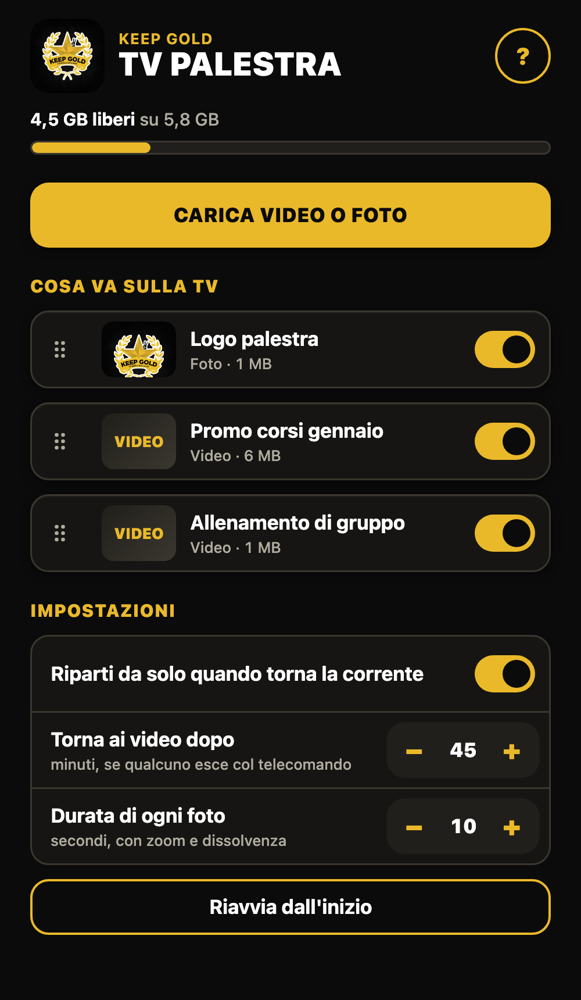
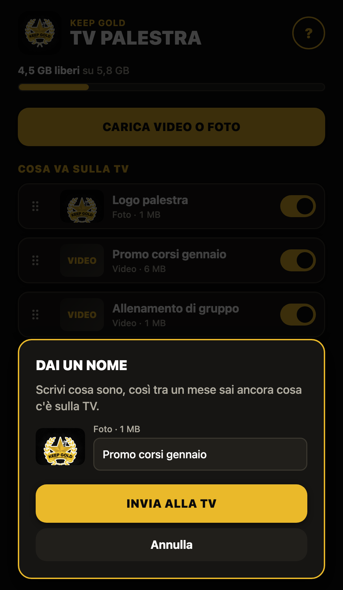
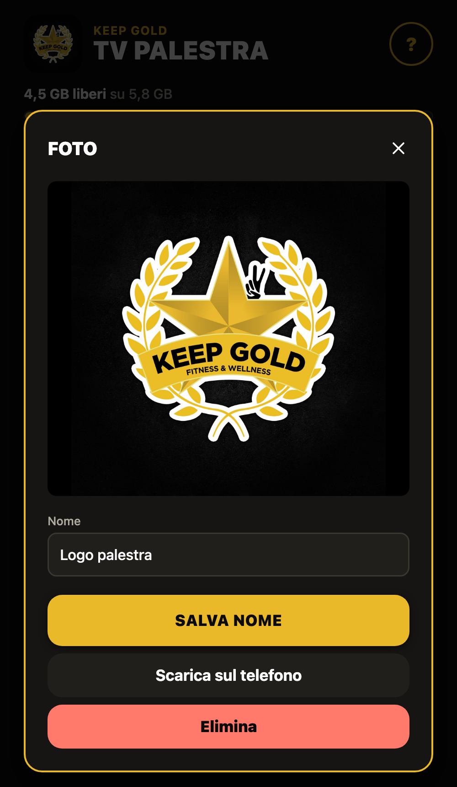

<p align="center"></p>

# firestick-keep-gold

App Android per Fire TV Stick che manda in loop video e foto sulla TV della palestra Keep Gold. Si accende da sola, funziona senza internet e si gestisce dal telefono sulla stessa wifi.

<p align="center">
  
  
  
</p>

## Cosa fa

- Dissolvenza di 3 secondi tra tutti i contenuti, audio compreso, senza passare dal nero. Se il contenuto successivo tarda a caricarsi, la dissolvenza si accorcia.
- Zoom lento sulle foto, dal 100% al 125%, per tutta la loro durata. Se il contenuto successivo tarda, lo zoom continua ancora un po'.
- Riparte da sola dopo un blackout e torna ai video se qualcuno esce col telecomando.
- Pagina web per caricare, rinominare, riordinare, scaricare ed eliminare i contenuti, anche da computer.
- Se il browser lo permette, i video vengono convertiti sul telefono prima dell'invio, così la chiavetta li riproduce senza scatti. Altrimenti viene inviato il file originale.

## Guida per chi la usa

Il PDF con le foto dello schermo è in [`guida/Guida TV Palestra.pdf`](guida/Guida%20TV%20Palestra.pdf).

## Installazione

Servono Java 17, Android SDK e `adb`. Sulla Fire TV attiva Debug ADB in Impostazioni › La mia Fire TV › Opzioni sviluppatore.

```bash
cd monitor-app
./gradlew assembleDebug
adb connect INDIRIZZO_TV:5555
adb install -r app/build/outputs/apk/debug/app-debug.apk
adb shell am start -n it.keepgold.monitor/.MainActivity
```

Se `adb install -r` si rifiuta perché la firma è diversa (app compilata su un altro computer), esegui prima `adb uninstall it.keepgold.monitor`: i video restano, le impostazioni tornano a quelle iniziali.

Il pannello è su `http://INDIRIZZO_TV:8000`. Finita l'installazione, disattiva Debug ADB.

## Com'è fatto

| Cartella | Contenuto |
| --- | --- |
| `monitor-app/` | App nativa: player con ExoPlayer e server web con NanoHTTPD |
| `monitor-app/app/src/main/assets/web/` | Pannello di gestione |
| `design-system/` | Colori e stili Keep Gold |
| `guida/` | Guida in PDF e relative immagini |

I contenuti stanno sulla chiavetta in `/sdcard/Movies/Negozio`.

## Limiti

- Provata solo su Fire TV Stick 2ª generazione (Fire OS 5.2.9.5, Android 5.1.1).
- Il pannello non ha password: chiunque sia sulla stessa wifi può gestire i contenuti. Usala su una rete fidata.
- La Fire TV non permette di disattivare le app di sistema Amazon.
